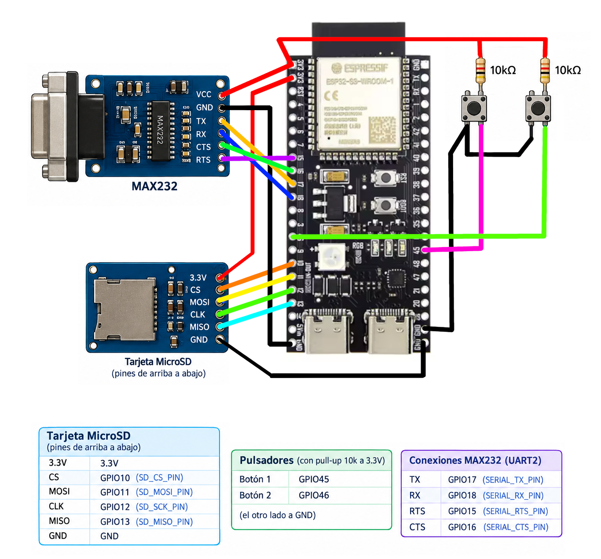
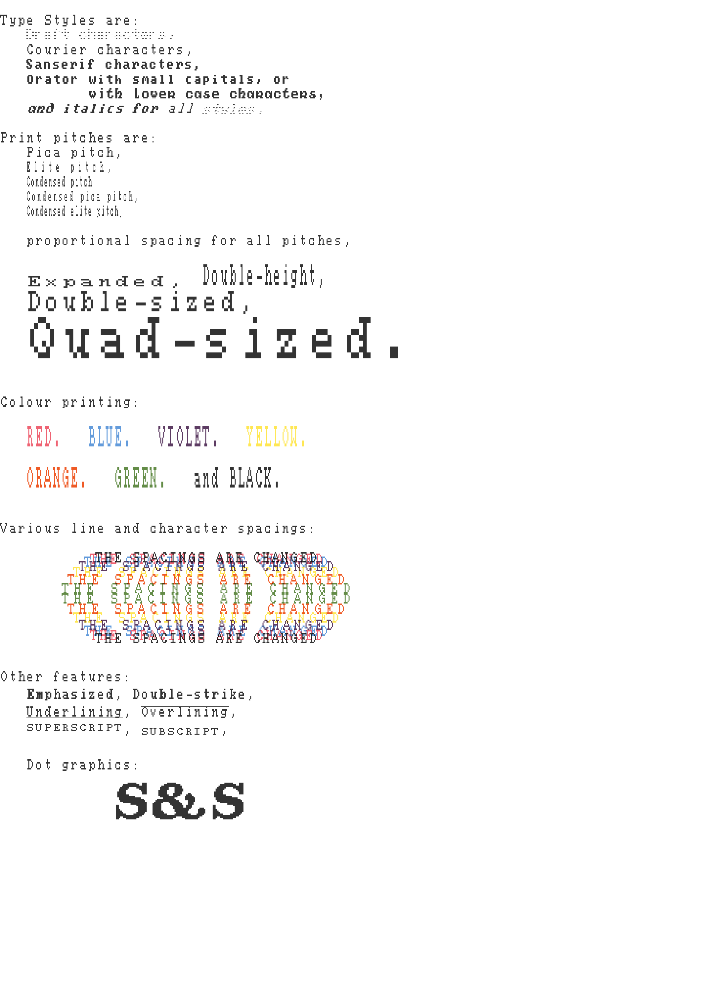
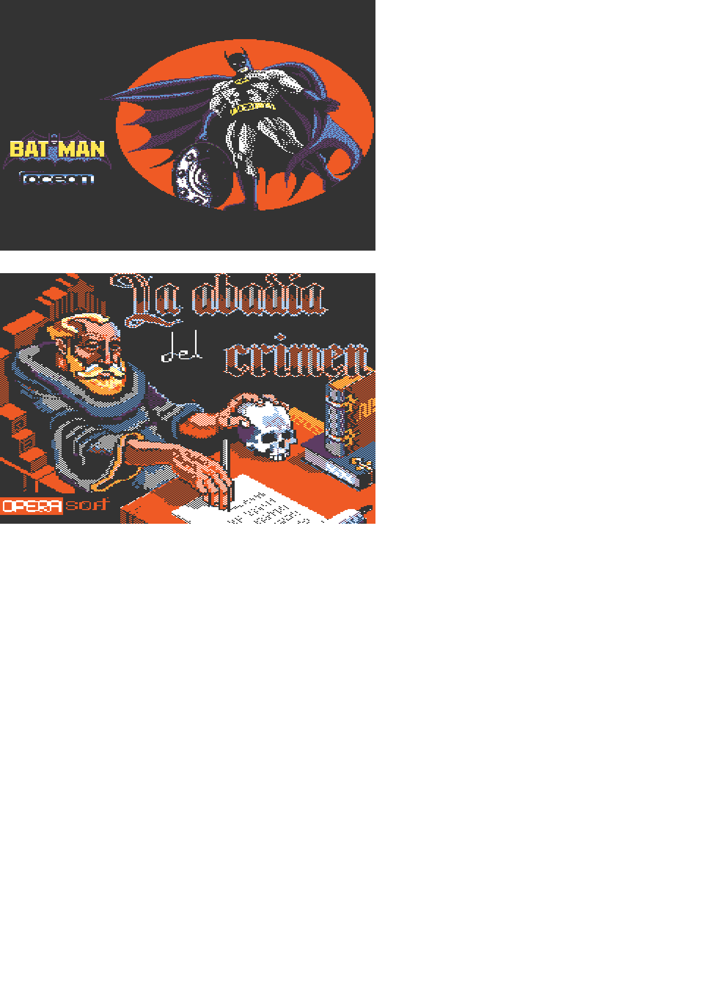
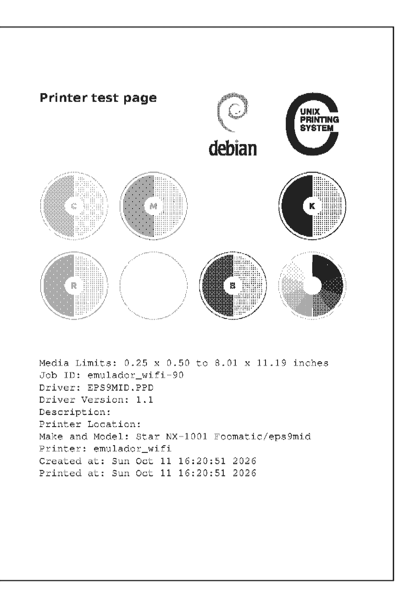

# Emulador de impresora ESP32
para ordenadores con puerto serie RS232.

Este proyecto ha sido desarrollado con ayuda de una IA (Claude) mediante programación asistida por IA.

El proyecto se basa en el hardware de fujinet-rs232.
Consulta las directivas `#define` de `esp32printer.ino` para ver la asignación de pines.

## Esquema

## Información

Proporciona un segundo puerto serie, incluido el control de flujo por hardware, que emula una impresora matricial en color tipo Epson. Acepta un subconjunto de las secuencias de escape ESC/P.

Genera archivos `.bmp` y `.pdf` por cada hoja de tamaño A4 impresa.

Opcionalmente, el archivo BMP se puede enviar a una impresora de red conectada a la misma Wi-Fi. La impresora debe ser compatible con IPP Everywhere, como sucede con la mayoría de las impresoras actuales.

También incorpora un servidor web con varias funciones:

* Permite ver la página que se está imprimiendo.
* Permite configurar las opciones de la impresora y la dirección IP de la impresora física.
* Permite gestionar la tarjeta SD: consultar impresiones anteriores en BMP, descargar su versión PDF, enviarlas a una impresora y eliminarlas.

El proyecto sigue en desarrollo y, por ahora, solo implementa las funciones básicas.

De forma predeterminada, está configurado para un ordenador Sinclair QL: 9600 baudios, formato 8N1 y retorno de carro automático (`CR`) después de cada salto de línea (`LF`). Estos parámetros se pueden cambiar en la página de configuración.

## Carpeta `font`

Incluye algunas pequeñas herramientas escritas en Python para convertir y editar fuentes de 768 bytes del ZX Spectrum y utilizarlas en la impresora. Para las distintas fuentes compatibles, utilizo algunas de las disponibles en https://github.com/ZXSpectrumVault/zx-fonts.

Estas son las fuentes que utilizo:

* `courier` - A Fistful of Blood Capsules (1987)(Zodiac Software)[end]#37966.ch8
* `prestige` - A Fistful of Blood Capsules (1987)(Zodiac Software)(Part 1 of 3)#37966.ch8
* `roman` - Fall of Rome, The (1984)(ASP Software)#56501.ch8
* `script` - Damned Forest, The (1988)(Cult Games)#64000.ch8
* `OCR-A` - Adventure F - The Eye of Bain (1984)(Artic Computing)#30263.ch8
* `OCR-B` - Alcatraz Harry 2 - The Doomsday Mission (1984)(Scorpio Gamesworld)#62602.ch8

## Estado del LED

El LED RGB de la placa indica el estado de la impresora:

* **ROJO**: error al acceder a la tarjeta SD.
* **VERDE**: el papel ha sido expulsado. La última impresión se puede consultar en `/current.bmp`. La siguiente impresión se guardará en un nuevo archivo BMP.
* **AZUL**: la impresora está esperando un nuevo comando. Al pulsar el botón `FF`, se completa la página y el LED pasa a verde. (Mientras el LED está azul, es posible que la parte final de la impresión no aparezca en la web; es necesario enviar un `CR` o un `FF`).
* **CIAN**: la impresora está procesando y dibujando los comandos recibidos.
* **MORADO**: la impresora está recibiendo datos y comienza a imprimir.
* **AMARILLO**: se ha pulsado el botón `FF` y la página se está expulsando.

## Funciones previstas

### Pendientes de la emulación de impresora

* Fuente proporcional.
* Fuentes NLQ reales (calidad cercana a carta).
* Fuentes cargables y almacenadas en RAM.
* Configuración de los juegos de caracteres nacionales y del cero tachado.
* Fuentes configurables por el usuario.
* Configuración de los márgenes laterales de la página.
* Configuración del número de bits, la paridad y los bits de parada.

### Pruebas pendientes

* Verificar el funcionamiento con los controladores de Windows y Linux.
* Verificar el funcionamiento con BannerMania para MS-DOS.
* Verificar el funcionamiento en otros sistemas: ZX Spectrum, Amstrad y Enterprise.

### Otras tareas pendientes

* Permitir configurar el nombre del dispositivo (hostname).
* Poder buscar otros dispositivos por su nombre, no solo por su dirección IP.
* Buscar y mostrar las impresoras disponibles.

## Estado actual

* Puerto serie y funcionamiento configurables.
* Compatibilidad con todos los estilos de texto de ESC/P.
* Compatibilidad con la selección de colores.
* Generación de un archivo `.bmp` y otro `.pdf` al completar una página.
* Envío de páginas a impresoras compatibles con IPP Everywhere, tanto manual como automático.
* Gestión de archivos limitada.

Estos son algunos ejemplos de las funciones compatibles:

Demostración básica en color de la Star LC 10, tomada de su manual:

Volcado en color de la pantalla de carga de un juego de QL, realizado con `sdump` de Miracle:

Conectado a un PC con Debian 13 (es necesario configurar `AUTO_CR_ON_LF = false`):

